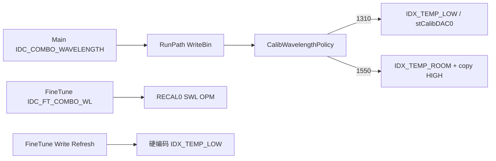

# FineTune 按波长写对应 DAC 槽位

## 现状

- 主流程已正确：[`CalibWavelengthPolicy.cpp`](M576Calibrator/M576CalibratorApp/CalibWavelengthPolicy.cpp) + [`LutMerge1550.cpp`](M576Calibrator/M576CalibratorApp/LutMerge1550.cpp)
- FineTune Write/Refresh 写死低温：[`FineTuneBinPatch.cpp`](M576Calibrator/M576CalibratorApp/FineTuneBinPatch.cpp) 中 `WriteMcsLutDacPair(..., IDX_TEMP_LOW)` / `WriteMems1x64LowTempDacPair`
- FineTune 波长下拉只服务光路（`CollectTlsAndWavelength`），与写 bin 无关

## 决策（本方案固定）

1. **波长源**：以 FineTune 页 `m_comboWl` 为准（与 Read Before/After 光路一致）；打开 FineTune 时用主界面 `m_strWavelength` 初始化下拉，之后不强制双向同步。
2. **1550 写回**：与主流程一致 —— 写 ROOM，再拷贝到 HIGH（MCS `IDX_TEMP_HIGH`；1x64 `stCalibDAC[2] = stCalibDAC[1]`）。
3. **范围**：仅 FineTune Refresh/Write（及 `FineTuneBinPatch`）；FullEdit 已按 LOW/ROOM/HIGH 三档 CSV 编辑，不改。

## 目标行为

| FineTune 波长 | Refresh Current DAC | Write Bin |
|---|---|---|
| 1310 | 读 LOW / `stCalibDAC[0]` | 只写 LOW |
| 1550 | 读 ROOM / `stCalibDAC[1]` | 写 ROOM，并拷 HIGH |

日志写明槽位（如 `slot=LOW(1310)` / `slot=ROOM+HIGH(1550)`），避免误判。

## 实现要点

### 1. 扩展 `FineTuneBinPatch` API

[`FineTuneBinPatch.h`](M576Calibrator/M576CalibratorApp/FineTuneBinPatch.h) / [`.cpp`](M576Calibrator/M576CalibratorApp/FineTuneBinPatch.cpp)：

- `FineTuneReadCurrentDac` / `FineTuneWriteDac` 增加 `int wavelengthNm`（或 `M576CalibBinWritePolicy`）
- 内部用已有 `PolicyFromWavelengthNm` + `McsPrimaryTempSlot` / `MemsPrimaryCalibSlot`
- MCS Write：`WriteMcsLutDacPair(..., mcsTempSlot, ...)`；若 1550，再把该 ch 的 ROOM 拷到 HIGH（单通道，勿整表 merge）
- MEMS Write：`WriteMems1x64DacPair(..., memsCalibSlot)` 替代 `WriteMems1x64LowTempDacPair`；1550 时拷贝 `stCalibDAC[2]`
- 更新头注释（去掉 “only low-temp”）
- `FineTuneReadTripleDac` 保持读三档（FullEdit 仍用），不变

### 2. FineTune UI 接线

[`M576FineTuneDlg.cpp`](M576Calibrator/M576CalibratorApp/M576FineTuneDlg.cpp) / [`.h`](M576Calibrator/M576CalibratorApp/M576FineTuneDlg.h)：

- 构造或 `OnInitDialog`：从 owner 主波长初始化 `m_comboWl`（需 owner 提供 getter，或构造参数传入 `initialWavelengthNm`）
- `OnBnClickedRefresh` / `OnBnClickedWrite`：`CollectTlsAndWavelength` 得到 `wavelengthNm` 后传入 Read/Write
- 可选：`ON_CBN_SELCHANGE(IDC_FT_COMBO_WL)` → 自动 Refresh（地址合法时），避免 UI 显示仍是旧槽 DAC
- 状态行/成功日志带波长与槽位说明

[`M576CalibratorDlg.cpp`](M576Calibrator/M576CalibratorApp/M576CalibratorDlg.cpp) `OnBnClickedFineTune`：创建时把当前 `m_strWavelength` 传给 FineTune（小改构造或 setter）。

### 3. 内存同步

`OnFineTuneBinPatched` 已用 `FineTuneSyncPayload` 整包 LUT/MEMS 覆盖内存；Write 路径写完 bin 后 payload 已含正确槽位即可，一般无需再改主对话框。

### 4. 验证

- 若易抽纯函数（policy→slot），可在 CrossPeakTest 加 2～3 个断言；否则手工：同 bin 下 1310 Write 只动 LOW，1550 Write 动 ROOM+HIGH、LOW 不变
- 提交前仍跑：`CrossPeakTest` Release Win32（若有相关用例改动）

## 预期改动文件

- [`M576Calibrator/M576CalibratorApp/FineTuneBinPatch.h`](M576Calibrator/M576CalibratorApp/FineTuneBinPatch.h)
- [`M576Calibrator/M576CalibratorApp/FineTuneBinPatch.cpp`](M576Calibrator/M576CalibratorApp/FineTuneBinPatch.cpp)
- [`M576Calibrator/M576CalibratorApp/M576FineTuneDlg.h`](M576Calibrator/M576CalibratorApp/M576FineTuneDlg.h)
- [`M576Calibrator/M576CalibratorApp/M576FineTuneDlg.cpp`](M576Calibrator/M576CalibratorApp/M576FineTuneDlg.cpp)
- [`M576Calibrator/M576CalibratorApp/M576CalibratorDlg.cpp`](M576Calibrator/M576CalibratorApp/M576CalibratorDlg.cpp)（打开时传初始波长；若加 getter 则 `.h` 一并）
- [`M576Calibrator/M576CalibratorApp/M576CalibratorDlg.h`](M576Calibrator/M576CalibratorApp/M576CalibratorDlg.h)（可选）
- 可选：[`M576Calibrator/CrossPeakTest/main.cpp`](M576Calibrator/CrossPeakTest/main.cpp)（slot 映射单测）

**不改**：FullEdit / Small Range / 主 Run Path / `LutMerge1550`（已正确）。
