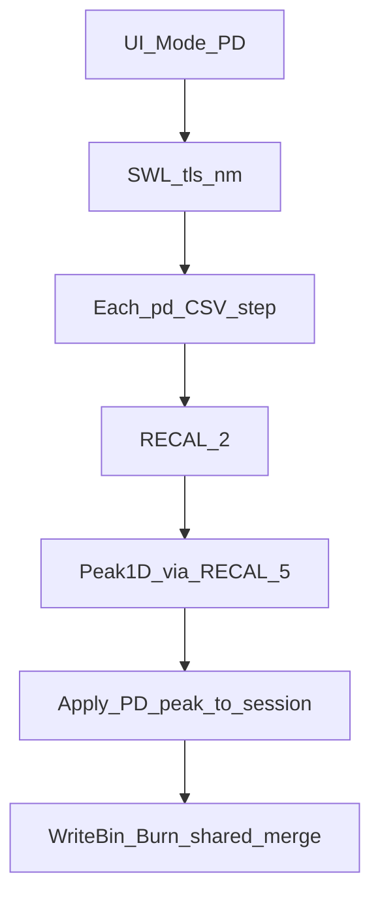

# PD 定标按 0415 协议重审重写

## 目标与硬约束

- **目标**：对照 [doc/固件/Z4744 Firmware Upgrade tips_20260415.xlsx](doc/固件/Z4744%20Firmware%20Upgrade%20tips_20260415.xlsx) 最新页 **0415 Command C**，从协议 wire → 路径 CSV → 扫频/寻峰 → LUT/MEMS 落盘，重新验收并重写 **PD 编排**；不默认信任现有 `RunPathPd*`。
- **硬约束**：**不得改动 PM 定标行为**。`RunPathPowerMeter*`、`RECAL 0/1/3`、`pm_*.csv` / `pm_*Mapping.csv`、`Pm1x64Mapping*`、INV-16/17 的 PM 语义一律冻结。
- **独立方式**：Mode=PM 与 Mode=PD 仅在 UI 分派处汇合；PD 不得向 PM 函数塞条件分支补丁。

## 0415 协议验收清单（PD）

| # | 固件约定 | 上位机验收点 |
|---|----------|--------------|
| C1 | 无 Command A | PD Run Path 禁止发 `RECAL 0`；不依赖 pm_range |
| C2 | 波长 | 启动时 `SWL tls nm`（PD 模式仍可配 TLS/波长） |
| C3 | `RECAL 2 t ch1 ch2` → OK | t 1..4；ch1=2#1x64 1..64；ch2=MCS 1..18 |
| C4 | 光路半区 | t=3 ⇒ ch1 1..32；t=4 ⇒ ch1 33..64 |
| C5 | target 语义 | 1/2=2#1x64 Stage1/2；3/4=1#/2# MCS；不校 1#1x64 |
| C6 | `RECAL 5` 与 `RECAL 3` 同构 6 参 | mode baseX baseY offset step delay；9999=FW 读基 |
| C7 | 不做 PM 挡位 | 禁止 INV-16 / opm 挡位校验 |
| C8 | 路径预算 | 64+3+576+576=1219；分文件 pd_mcs1 / pd_mcs2 / pd_1x64_2 |

## 隔离架构（选定）

抽出 PD 编排模块，Dlg 只做分派；**PM 函数体零改动**。

新建：

- [M576Calibrator/M576CalibratorApp/PdRunPath.h](M576Calibrator/M576CalibratorApp/PdRunPath.h) / `PdRunPath.cpp`
  - `RunPdCalibrate`：PD 会话入口
  - `RunPdFile`：单槽 CSV
  - 注入：`CRecalSession*`、日志、进度、session LUT/MEMS、delay/range/step、轴序

Dlg：`PathWorkerEntry` 在 PD 模式调用新模块；掏空现有 `RunPathPd` / `RunPathPdFile`，避免双份逻辑。

**允许复用但须用 CrossPeakTest 重新钉死契约**：

- `RecalSession` 的 RECAL2/5 API（对照 C3/C6；错则只改 PD 侧）
- `Peak1DSweepPipeline` / `RunRecal1DSweepWithPeakRecenterRetry(..., isPm=FALSE)` — **禁止**改 `isPm==TRUE` 行为
- `TransSlotFromPdTarget` / `ValidatePathStepPd` / `LoadPathCsvPd`

**Write Bin / Burn**：模式无关合并；PD 只保证写入 MCS0/1 + 仅 2#1x64（`m_mems1x64[1]`）。

### 明确不碰的 PM 面

- `RunPathPowerMeter` / `RunPathPowerMeterFile`
- `ExchangeRecal0/1/3`
- `Pm1x64Mapping*`、`pm_*Mapping.csv`
- INV-16/17、`PmRangeValidation`
- `output/pm_*.csv`

## PD 落盘规则

1. **MCS（t=3/4）**：`ch1`→sw、`ch2-1`→ch；低温槽；Y→`[0]`、X→`[1]`。CrossPeakTest 固定写址用例。

2. **2#1x64（t=1/2）**：废弃 `ApplyRecalPeakToMems1x64Pd` 的 port/16。新建 `Pd1x64Mapping` + `pd_1x64_2Mapping.csv`（与路径 CSV 同行序；前三列一致；`SW_x`/`CH_y` → `WriteMems1x64LowTempDacPair`）。映射缺失或错行 → 跳过该槽并明确失败。**禁止修改** `Pm1x64Mapping.cpp`。

3. **INV-15**：PD 扫频/跳过失败必须 `PushPathFailureOutcome`（消灭现有死代码路径）。

## UI / 常量 / 文档

- PD：隐藏 pm_range；**保留 TLS+波长**（供 SWL）
- Path hint：仅 pd_mcs1|mcs2|1x64_2；注明不校 1#1x64
- [CalibConstants.h](M576Calibrator/M576CalibratorApp/CalibConstants.h)：PD 默认 CSV 与 Mapping 命名
- 更新使用说明与 [doc/INVARIANTS.md](doc/INVARIANTS.md) 增补 INV-PDx
- 修正 `generate_sample_path_pd_1219.py` 输出分文件 pd_*.csv

## 测试与回归门禁

1. CrossPeakTest 新增：RECAL2/5 命令串、半区校验、trans 映射、PD 写址/Mapping、failure outcome
2. PM 回归：现有用例全绿；确认未改 `RunPathPowerMeter*` / `Pm1x64Mapping*`
3. 提交前：`msbuild CrossPeakTest` + 跑 `CrossPeakTest.exe`
4. 实机短路径：PD comm 无 RECAL0、有 SWL/RECAL2/RECAL5；PM 短跑仍为 RECAL0→1→3

## 实施顺序

1. 先写协议契约测试（红灯暴露现状）
2. 新建 `PdRunPath` + `Pd1x64Mapping`；Dlg 改分派
3. 重做 LUT/MEMS PD apply + outcome；校正 CSV/Mapping
4. 删旧 `RunPathPd*`；文档/INV
5. 回归门禁 + 可选实机 comm 对表

## 风险

- Peak1D 共享：只经 `isPm=FALSE` + RECAL5 回调接入；改 Peak1D 须证明不影响 PM
- RECAL5 功率刻度默认与 RECAL3 同形；若实机不同，只在 PD 适配层改
- PD Mapping 需与固件 2#1x64 SW/CH 对齐；首轮可参考 PM `pm_1x64_2Mapping` 几何再与固件确认
